# ⚡ Awesome AI CLI Assistant & Terminal Agent Ecosystem 🤖

  

  
  
  
  
  
  

---

## 🌟 Curated List of SaaS Products & Open-Source GitHub Projects

> *A comprehensive, community-maintained directory of **autonomous terminal agents**, **AI command-line assistants**, **natural language shell copilot wrappers**, **AI git commit generators**, **terminal user interface (TUI) coding harnesses**, and **Model Context Protocol (MCP) CLI extensions**.*

**Last updated: November 2026** 📅

This repository tracks notable **SaaS platforms** and **open-source projects** in the rapidly expanding **AI CLI Assistant & Terminal Agent** ecosystem. These intelligent developer tools embed autonomous reasoning and LLMs directly inside the command line—translating natural language queries into executable bash/zsh commands, autonomously executing multi-step terminal workflows, inspecting multi-file codebases, diagnosing runtime stack traces, running test suites, and automating Git commits and reviews.

- **Enterprise & SaaS Leaders**: Warp AI, Amazon Q Developer CLI, GitHub Copilot CLI, Termius AI, Anthropic Claude Code, and Atlassian Rovo Dev.
- **Open-Source Powerhouses**: OpenCode, OpenAI Codex CLI, Gemini CLI, Goose, Aider, Open Interpreter, ShellGPT, Ollama, Mods, and AIChat.

---

## 📑 Table of Contents

- [📊 Sector Overview & Market Dynamics](#-sector-overview--market-dynamics)
- [☁️ SaaS & Hosted Platforms](#️-saas--hosted-platforms)
- [💻 Open-Source GitHub Projects](#-open-source-github-projects)
- [🤝 How to Contribute](#-how-to-contribute)
- [💖 Support & Sponsorship](#-support--sponsorship)
- [⭐ Star History](#-star-history)
- [📜 Disclaimer](#-disclaimer)

---

## 📊 Sector Overview & Market Dynamics

The global **AI developer tools and agentic coding ecosystem** is estimated at **$7B–$10B** (projected to reach **$26B–$60B+** by the early 2030s at an aggressive ~25% CAGR). 

The market structure is **moderately concentrated at the foundation and IDE layer**—led by cloud hyperscalers and frontier AI labs (Microsoft/GitHub, Amazon AWS, Anthropic, Google)—while remaining **highly fragmented across specialized terminal agents, autonomous CLI workflows, Unix shell pipelines, and open-source developer tooling** where agile startups and community projects drive rapid innovation.

---

## ☁️ SaaS & Hosted Platforms

| Product | Company Valuation / Revenue | Pricing (Starting Paid Tier) | Free Tier Limits | Description |
| :--- | :--- | :--- | :--- | :--- |
| **[GitHub Copilot CLI](https://github.com)** | ~$3.77T Market Cap / ~$346B Revenue (Microsoft) | $10/month (Pro plan) | Free forever plan: 2,000 code completions/month and limited Copilot CLI chat interactions | Official GitHub command-line AI assistant and terminal agent capable of explaining shell commands, suggesting git/gh workflows, and executing repository tasks directly in the terminal. |
| **[Amazon Q Developer CLI](https://amazon.com)** | ~$2.85T Market Cap / ~$777B Revenue (Amazon) | $19/user/month (Pro plan) | Free forever plan: 50 agentic requests/month and 1,000 lines of code transformation/month | Cloud-backed AI command-line assistant providing IDE-style terminal autocomplete, natural-language-to-bash translation, and agentic codebase/AWS troubleshooting. |
| **[Anthropic Claude Code](https://anthropic.com)** | ~$1.5T Valuation / ~$81B ARR Run-rate | $20/month (Claude Pro plan; or pay-per-token API) | No free tier (free CLI download, but requires paid Pro subscription at $20/mo or Anthropic API key to run) | Agentic terminal coding and command-line assistant that understands entire repositories, executes shell commands, runs tests, and manages Git workflows via MCP and `SKILL.md`. |
| **[Atlassian Rovo Dev CLI](https://atlassian.com)** | ~$36B Market Cap / ~$6.5B Revenue (Atlassian) | $17.65/user/month (Cloud Standard tier with Rovo credits) | 30-day free trial on Rovo Dev Standard (2,000 credits/user/month); 14-to-30 day Cloud trial (25–70 Rovo credits/user/month). No perpetual free plan. | Enterprise cloud-connected terminal agent linking local CLI coding and shell automation directly with Jira tickets, Confluence docs, and Bitbucket pull requests. |
| **[Warp (Warp AI & Oz Agents)](https://warp.dev)** | ~$290M+ Valuation / ~$85M Funding | $20/month (Build plan; $18/mo billed annually) | Free forever plan: 0 managed AI agent credits (BYOK allowed for individuals/small teams ≤10), up to 30 cloud-synced conversations, unlimited core terminal | Modern GPU-accelerated terminal and Agentic Development Environment featuring natural-language command generation, multi-agent cloud/local execution, and team Warp Drive notebooks. |
| **[Wave Terminal Cloud Sync](https://waveterm.dev)** | Seed-stage Startup / Open-Core | ~$15–$20/month (Planned Pro Cloud Sync tier) | Free forever plan: 100% free and unlimited local terminal usage (BYOK for LLM providers & local Ollama models; no login required) | Hybrid open-core graphical terminal combining inline file/web previews with cloud-synced workspaces and integrated multi-model AI command blocks. |
| **[Termius AI](https://termius.com)** | ~$4M–$4.5M ARR / $4.1M Seed Funding | $10/month (Pro plan; billed annually) | Free forever plan (Starter): Single local device only, no multi-device cloud sync; 14-day free trial available for Pro | Cross-platform SSH client and cloud-synced DevOps workspace featuring built-in AI command generation, log diagnostics, and shared team snippet vaults. |
| **[Butterfish](https://butterfish.io)** | Open-Source / Pre-revenue | $0 (100% Free / Self-hosted BYOK) | Free forever: 100% free open-source tool with no software usage limits; users provide their own OpenAI/LLM API keys | Commercial-friendly AI shell wrapper that embeds persistent LLM context directly into standard `bash` and `zsh` sessions for seamless command suggestions and error explanations. |

---

## 💻 Open-Source GitHub Projects

*Ranked strictly by GitHub Stars_Count (descending) with live badges linking to each repository's stargazers.*

- **[OpenCode (`anomalyco/opencode`)](https://github.com/anomalyco/opencode)**   
  ⚡ The open-source (`MIT`) terminal-native AI coding agent featuring a high-performance TUI, LSP diagnostics, client/server orchestration, and multi-provider LLM support (Claude, OpenAI, Gemini, Ollama).

- **[Oh My Zsh (`ohmyzsh/ohmyzsh`)](https://github.com/ohmyzsh/ohmyzsh)**   
  🐚 Iconic community-driven (`MIT`) Zsh framework with 300+ plugins, auto-suggestions, and deep AI terminal shell assistant integrations (`zsh-autosuggestions`, `zsh-ai`).

- **[Ollama (`ollama/ollama`)](https://github.com/ollama/ollama)**   
  🦙 Get up and running with local open-weight large language models (`DeepSeek`, `Qwen2.5-Coder`, `Llama 3`, `Gemma`) directly from the CLI or behind local terminal agents.

- **[OpenAI Codex CLI (`openai/codex`)](https://github.com/openai/codex)**   
  🤖 Official open-source (`Apache-2.0`) lightweight terminal coding agent written in Rust featuring OS-level sandboxing (`Seatbelt` / `Landlock`), multimodal input, and MCP server connectivity.

- **[llama.cpp (`ggml-org/llama.cpp`)](https://github.com/ggml-org/llama.cpp)**   
  ⚡ Ultra-fast LLM inference in C/C++ providing the high-speed backend engine powering private, offline terminal assistants on CPU and GPU.

- **[Gemini CLI (`google-gemini/gemini-cli`)](https://github.com/google-gemini/gemini-cli)**   
  ✨ Google's official open-source (`Apache-2.0`) command-line AI agent delivering native Gemini models, real-time Google Search grounding, shell execution tools, and MCP extensions.

- **[Model Context Protocol Servers (`modelcontextprotocol/servers`)](https://github.com/modelcontextprotocol/servers)**   
  🔌 The official reference repository of Model Context Protocol (MCP) servers providing terminal coding agents with standard filesystem, Git, GitHub, PostgreSQL, Docker, and shell execution capabilities.

- **[Lazygit (`jesseduffield/lazygit`)](https://github.com/jesseduffield/lazygit)**   
  🐙 Simple, elegant terminal UI for git commands with seamless integration for AI-powered commit messages and diff analysis.

- **[Open Interpreter (`openinterpreter/openinterpreter`)](https://github.com/openinterpreter/openinterpreter)**   
  🧠 Natural-language computer interface enabling LLMs to write and execute Python, JavaScript, and Bash commands locally with interactive terminal safety confirmation.

- **[Ghostty (`ghostty-org/ghostty`)](https://github.com/ghostty-org/ghostty)**   
  👻 Fast, feature-rich, GPU-accelerated cross-platform terminal emulator written in Zig that serves as the premier host runtime for modern terminal agents and TUI harnesses.

- **[Goose (`aaif-goose/goose`)](https://github.com/aaif-goose/goose)**   
  🪿 Extensible open-source (`Apache-2.0`) autonomous developer agent from Block that installs tools, edits codebases, executes shell actions, and runs automated tests via any LLM and MCP.

- **[Aider (`Aider-AI/aider`)](https://github.com/Aider-AI/aider)**   
  🧑‍💻 The gold-standard AI pair programming CLI tool that maps your repository AST, edits code across multiple files, executes linters/tests, and automatically crafts clean git commits.

- **[Fabric (`danielmiessler/Fabric`)](https://github.com/danielmiessler/Fabric)**   
  🧵 An open-source framework for augmenting human intelligence with AI via composable Unix command-line pipes, structured markdown patterns, and community prompt libraries.

- **[Crush (`charmbracelet/crush`)](https://github.com/charmbracelet/crush)**   
  💖 Glamorous terminal-based agentic coding tool built by Charm combining an ultra-clean Lip Gloss TUI with multi-model intelligence, LSP context, and MCP tool interoperability.

- **[Wave Terminal (`wavetermdev/waveterm`)](https://github.com/wavetermdev/waveterm)**   
  🌊 Open-source (`Apache-2.0`), AI-integrated, cross-platform terminal combining command blocks, inline web/graphical previews, and multi-model AI generation.

- **[Plandex (`plandex-ai/plandex`)](https://github.com/plandex-ai/plandex)**   
  📋 Open-source (`AGPL-3.0`) terminal coding engine designed for complex, multi-file software engineering tasks with versioned branches, sandbox execution, and protected diff reviews.

- **[LLM (`simonw/llm`)](https://github.com/simonw/llm)**   
  🛠️ Extensible CLI utility and Python library by Simon Willison for prompting both remote and local LLMs, logging SQLite prompt interactions, and managing modular plugins.

- **[ShellGPT (`TheR1D/shell_gpt`)](https://github.com/TheR1D/shell_gpt)**   
  🐚 Popular command-line productivity tool powered by LLMs for generating shell commands, code snippets, chat sessions, and automated system administration tasks.

- **[AIChat (`sigoden/aichat`)](https://github.com/sigoden/aichat)**   
  💬 All-in-one Rust LLM CLI tool featuring interactive Shell Assistant mode, Chat-REPL, RAG document retrieval, function calling, custom agents, and support for 20+ model providers.

- **[Aicommits (`Nutlope/aicommits`)](https://github.com/Nutlope/aicommits)**   
  📝 Lightweight open-source (`MIT`) CLI tool that inspects staged `git diff` changes and automatically drafts Conventional Commit messages using AI.

- **[K8sGPT (`k8sgpt-ai/k8sgpt`)](https://github.com/k8sgpt-ai/k8sgpt)**   
  ☸️ Giving Kubernetes superpowers to SREs and DevOps teams by scanning clusters, analyzing anomalies, and delivering actionable natural-language remediation guidance in the terminal.

- **[kubectl-ai (`GoogleCloudPlatform/kubectl-ai`)](https://github.com/GoogleCloudPlatform/kubectl-ai)**   
  ☸️ Google Cloud's AI-powered Kubernetes terminal plugin that translates natural language into safe, verifiable `kubectl` manifests and operational commands.

- **[OpenCommit (`di-sukharev/opencommit`)](https://github.com/di-sukharev/opencommit)**   
  📦 Feature-rich AI Git commit generator supporting Claude, GPT-4, and local Ollama models with automated git hook installations.

- **[Mods (`charmbracelet/mods`)](https://github.com/charmbracelet/mods)**   
  ✨ Unix-native CLI tool by Charm designed for standard shell pipelines (`stdin`/`stdout`), seamlessly formatting Markdown, JSON, and code directly inside the terminal.

- **[gptme (`gptme/gptme`)](https://github.com/gptme/gptme)**   
  🤖 Autonomous personal AI assistant for your terminal equipped with local Python runtime, bash execution, web scraping, and persistent memory.

- **[tgpt (`aandrew-me/tgpt`)](https://github.com/aandrew-me/tgpt)**   
  💬 Fast, lightweight terminal AI chatbot that runs directly in your terminal without requiring API keys.

- **[RA.Aid (`ai-christianson/RA.Aid`)](https://github.com/ai-christianson/RA.Aid)**   
  🔬 Autonomous software engineering agent powered by LangGraph featuring a multi-agent Research, Planning, and Implementation architecture.

- **[Butterfish (`bakks/butterfish`)](https://github.com/bakks/butterfish)**   
  🐟 Open-source shell wrapper embedding persistent LLM prompting, autonomous shell agent modes, and semantic code search directly into `bash` and `zsh`.

---

## 🤝 How to Contribute

Contributions are welcome! Please follow these guidelines to add or update projects:

1. 🍴 **Fork** the repository.
2. 🌿 **Create a new branch**: `git checkout -b feat/add-new-tool`
3. 📝 **Add your tool** to `README.md` keeping descriptions factual, concise, and adhering to the table or star-sorted list formatting.
4. 🚀 **Submit a Pull Request** with a descriptive summary of the project.

---

## 💖 Support & Sponsorship

If you find this curated ecosystem list helpful for your developer workflows, terminal setups, or research, please consider supporting the project:

- ⭐ **Star this repository** to help others discover it!
- 🍴 **Fork and share** it with your developer community and colleagues.
- ☕ **Buy me a coffee**: Sponsor ongoing open-source maintenance directly on the [Sponsor Dashboard](https://github.com/sponsors/ishandutta2007).

Your support keeps this directory independent, accurate, and up-to-date! 🙏

---

## ⭐ Star History

---

## 📜 Disclaimer

*This curated directory is provided for informational and developer-productivity purposes only. Product names, logos, and trademarks are the property of their respective owners. Mention of SaaS products or commercial platforms does not imply endorsement or affiliation.*
